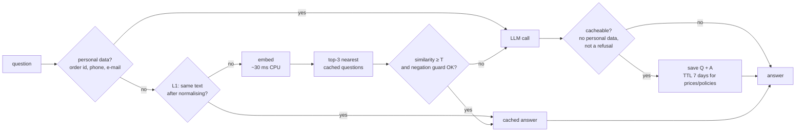

# Semantic cache for an FAQ bot

Answer repeat customer questions from a cache when the **meaning** matches, call the LLM only on
a miss, and **prove it with numbers**: hit rate, false hits and latency, measured on a labelled
English + Hinglish test set.

> **Result** (100 labelled questions, `paraphrase-multilingual-mpnet-base-v2`, CPU):
> **cache hit rate 20% at threshold 0.83 with 0 false hits** (0 on the held-out half too);
> **LLM calls down 20%** (100 → 80); in the end-to-end replay the **average latency fell from
> 801 ms to 696 ms**, with the LLM simulated at 800 ms per call. A cache hit is served in
> about 50 ms. An exact-text cache hit **0** of the same 100 questions.

All numbers come from `reports/` and were produced by the commands below on 19 Nov 2026
(Windows 11 laptop, Python 3.14, sentence-transformers 6.3, torch 2.15 CPU).

---

## How it works



* **Embeddings:** questions become unit-length vectors, so a dot product is the cosine
  similarity and search is one matrix multiply (NumPy) or `faiss.IndexFlatIP`.
* **Seeding:** the 30 FAQs are cached up front, each with 2 extra phrasings (90 entries).
* **Guards:** a negation guard ("refund milega" ≠ "refund nahi milega"), a personal-data guard
  (never cache or serve one person's data), TTL for volatile answers, and no caching of
  refusals or cut-off answers.
* **Multi-tenant:** one cache per tenant, so customer A never receives customer B's answers.
* **One source of truth:** the pure `decide()` function is used by the live cache *and* by the
  evaluation, so the report measures the exact code that serves traffic.

## Results

### Threshold sweep (all 100 questions: 60 should hit, 40 should not)

| threshold | hits | correct | **false hits** | recall (of 60) | precision | LLM calls |
|---|---|---|---|---|---|---|
| 0.75 | 36 | 31 | **5** | 52% | 86% | 64 |
| 0.80 | 26 | 24 | **2** | 40% | 92% | 74 |
| 0.85 | 16 | 16 | 0 | 27% | 100% | 84 |
| 0.90 | 8 | 8 | 0 | 13% | 100% | 92 |
| 0.95 | 1 | 1 | 0 | 2% | 100% | 99 |

**Why 0.83?** It was picked on a **dev half** (50 questions, 0.01 grid, rule: most hits with zero
false hits) and then checked on the **test half** it never saw: 8/30 correct hits, **0 false
hits**. On all 100 questions it gives 20 hits, all correct. Lower thresholds catch more
paraphrases but start returning wrong answers. In a support bot one confidently wrong answer
costs more than one LLM call, so the rule is "zero false hits first".

### The negation guard (at T = 0.83)

| | hits | correct | false hits |
|---|---|---|---|
| no guard | 24 | 19 | **5** |
| guard (skip if blocked) | 19 | 19 | 0 |
| guard + fall-through to next candidate | **20** | **20** | **0** |

False hits it caught, with no correct hit lost:
* "Why **can't** I cancel my order?" would have received the *how to cancel* answer.
* "Mera password reset **nahi** ho raha" would have received the *how to reset* answer.
* "My discount code **isn't** working, why?" matched *how to apply a coupon* first; the
  fall-through picked the right FAQ, *coupon not working* (0.83).

### Embedding model comparison (`reports/MODEL_COMPARISON.md`)

| model | extra phrasings | best T (dev) | correct / false (all 100) | correct / false at fixed 0.80 | lookup |
|---|---|---|---|---|---|
| all-MiniLM-L6-v2 (English only) | on | 0.80 | 15 / 0 | 15 / 0 | 10 ms |
| paraphrase-multilingual-MiniLM-L12-v2 | off | 0.68 | 20 / 2 | 8 / 1 | 18 ms |
| paraphrase-multilingual-MiniLM-L12-v2 | on | 0.89 | 6 / 0 | 13 / 2 | 20 ms |
| paraphrase-multilingual-mpnet-base-v2 | off | 0.69 | 29 / 3 | 15 / 1 | 26 ms |
| **paraphrase-multilingual-mpnet-base-v2** | **on** | **0.83** | **20 / 0** | 24 / 2 | 27 ms |
| multilingual-e5-small | on | 0.95 | 4 / 0 | 41 / **57** | 15 ms |

What this table teaches:
1. **A threshold is not portable.** At 0.80, e5-small returns 57 false hits, because its
   scores all sit high. Re-run the sweep whenever you change the model.
2. **Extra phrasings help recall at a fixed threshold** (mpnet: 15 → 24 correct at 0.80), but
   more entries also give "none" questions more near neighbours. Under a zero-false-hit rule the
   chosen threshold goes up, so the net gain is smaller than it looks.
3. **Romanised Hinglish is the weak spot.** For "Refund kab tak milega?" even the best
   cached match scores only 0.69. These models learned Hindi mostly in Devanagari script.

### End-to-end replay (`reports/replay.json`)

Every test question goes through the real request path twice, first with the cache off and then
on. **The LLM here is the offline stand-in, which sleeps 800 ms per call (simulated)**; all
cache-side times are measured.

| | LLM calls | tokens | avg latency | p50 | p95 |
|---|---|---|---|---|---|
| without cache | 100 | 147,678 | 801 ms | 801 ms | 801 ms |
| with cache | **80** | 118,038 | **696 ms** | 848 ms | 890 ms |

A cache **hit** takes 50 ms (p50); on a **miss** the cache adds 50 ms (p50) before the LLM
call. Run-to-run noise is real: the previous run gave 678 ms (−15%). Two earlier runs gave
906 and 996 ms, i.e. *slower* than no cache. One of them still embedded every miss twice
(fixed: `put()` now reuses the lookup vector, see `test_miss_embeds_the_question_only_once`),
and both hit 200-650 ms CPU spikes while the laptop was busy. Lesson: with a 20% hit rate the
cache only wins on average if a miss costs less than about 0.2 × 800 / 0.8 = 200 ms extra, so
keep the miss path lean. Token counts for the stand-in are rough estimates (4 characters ≈
1 token). Run
`FAQ_LLM_PROVIDER=anthropic faqcache replay` (or openai / gemini / ollama) for real numbers.

### Demo: one question, three phrasings (`faqcache demo`, cache starts empty)

```
Q: Can I pay with a credit card?
[LLM (miss)]    845.1 ms  sim=-      reason=empty_cache
Q: Is credit card payment accepted?
[CACHE HIT ]     55.0 ms  sim=0.891  reason=semantic_hit
Q: Credit card se payment ho sakta hai?
[CACHE HIT ]    110.1 ms  sim=0.861  reason=semantic_hit
```

(The full output is in `reports/demo_output.txt`. "Do you deliver on Sundays?" → "Kya Sunday ko
delivery hoti hai?" scored only 0.665 and missed, which is the Hinglish weak spot again.)

---

## Quick start

```bash
# 1. create a virtual environment (Python 3.11+)
python -m venv .venv
.venv\Scripts\activate            # Windows
# source .venv/bin/activate       # macOS / Linux

# 2. install (add ,anthropic / ,openai / ,gemini / ,ollama for a real LLM)
pip install -e ".[dev,faiss]"

# 3. settings (optional: the defaults work offline with the stand-in LLM)
copy .env.example .env            # Windows  (cp on macOS / Linux)

# 4. run
pytest                            # 50 offline tests (no model download needed)
faqcache demo                     # same question 3 ways: miss, then cache hits
faqcache ask "refund kab milega?"
faqcache eval                     # sweep + hold-out + guards -> reports/EVAL_REPORT.md
faqcache compare                  # embedding models side by side -> reports/MODEL_COMPARISON.md
faqcache replay                   # end-to-end without vs with cache -> reports/replay.json
faqcache serve                    # API at http://127.0.0.1:8000/docs
```

The first command that uses the real model downloads it from Hugging Face (about 1.1 GB for
mpnet; `compare` downloads all four models, about 2.5 GB).

**API**

```bash
curl -X POST http://127.0.0.1:8000/v1/ask -H "Content-Type: application/json" \
     -d "{\"question\": \"refund kab milega?\"}"
curl http://127.0.0.1:8000/v1/stats
```

**Using a real LLM**: set `FAQ_LLM_PROVIDER` and the provider's key (see `.env.example`).
The Anthropic client defaults to `claude-opus-5-5` at `effort: low`. It marks the FAQ system
prompt for prompt caching and enables the server-side refusal fallback; a refused answer is
returned but never cached.

## Project layout

```
src/faqcache/
  config.py       Settings (FAQ_* env vars, .env)
  data.py         FAQ + test-set models, stratified dev/test split
  embeddings.py   Embedder interface, sentence-transformers, offline hash embedder
  guards.py       negation guard, personal-data guard + redaction, TTL policy
  stores/         memory (NumPy), FAISS, Redis/RedisVL template
  cache.py        SemanticCache + pure decide()
  llm/            fake (offline), Anthropic, OpenAI, Gemini, Ollama
  service.py      FAQBot (cache -> LLM -> save -> log), per-tenant caches, JSONL logs
  factory.py      wires Settings -> objects
  api.py          FastAPI app
  evaluation.py   probes, sweep, hold-out, ablation, replay
  cli.py          faqcache ask | chat | demo | eval | compare | replay | serve
data/             30 FAQs (+60 phrasings), 100 labelled test questions
reports/          generated results (committed)
docs/ROADMAP.md   the 3-day build plan, step by step
```

## Interview talking points

* **Why semantic, not exact?** An exact cache hit 0 of the 100 questions: people never type the
  same sentence twice. A semantic cache hit 20 with zero wrong answers.
* **The false-hit risk.** A wrong cached answer is served fast *and* confidently to every
  later asker. That's why the threshold rule puts false hits first, why the negation guard
  exists (5 → 0 false hits), and why personal answers are never cached.
* **How I picked the number.** Swept 0.50-0.99, picked on a dev half and reported on a held-out
  half, so I'm not grading my own exam. The threshold must be re-tuned for each model.
* **Honest limits.** The test set is small (100) and written by one person, and the extra
  phrasings were written by the same person (risk of optimism). Hinglish recall is weak. LLM
  latency in the replay is simulated. Lookup latency is one laptop's CPU and it jitters: an
  embedding run right after the CPU sat idle was measured at 61 ms on average, with spikes up
  to 430 ms.
* **What changes at scale.** Redis/RedisVL as a shared cache for many API workers (template in
  `stores/redis_template.py`); an approximate index (HNSW) and a recall re-check; TTL and
  invalidation when a policy changes; one namespace per tenant; GPU or batched embeddings;
  metrics (hit rate, false-hit reports from 👎 feedback, p95 latency); a cross-encoder
  re-ranker on the top 3 to raise recall without raising false hits.

## Limitations and next steps

* Stretch goals: cross-encoder re-ranker, entity guard ("7 days" ≠ "30 days"), per-category
  thresholds, a 👎 button that evicts a cached answer, Prometheus metrics.
* `Dockerfile`, `docker-compose.yml` and the Redis/OpenAI/Gemini/Ollama/Anthropic clients are
  provided but were **not run** while building this repo (no Docker, no API keys on the build
  machine). The offline path, tests, evaluation, comparison and replay **were** run.
* DemoMart and every FAQ are fictional.

## License

MIT
